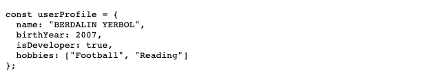
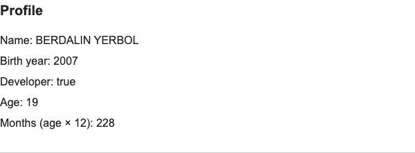
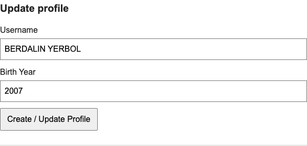
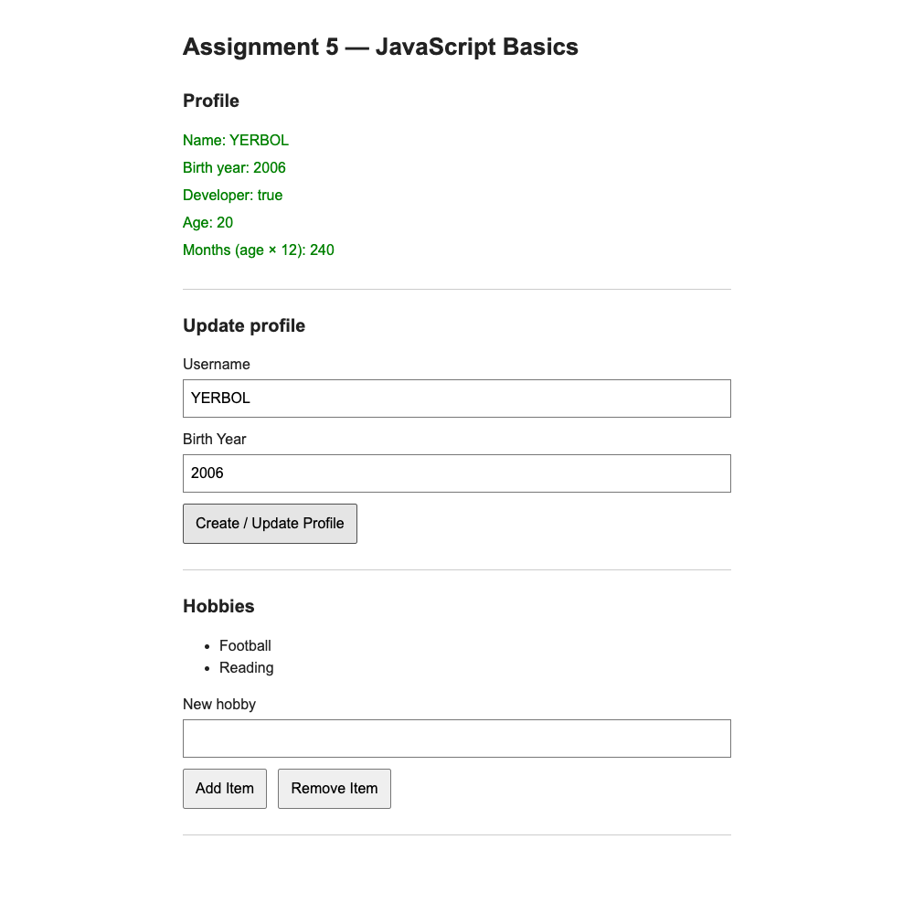
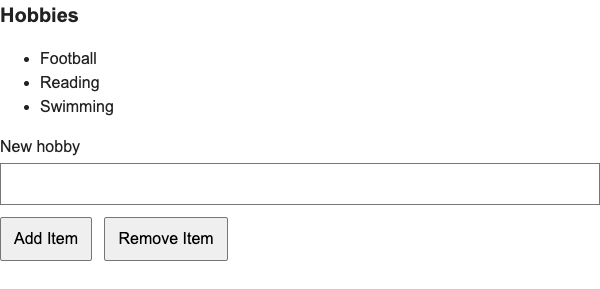
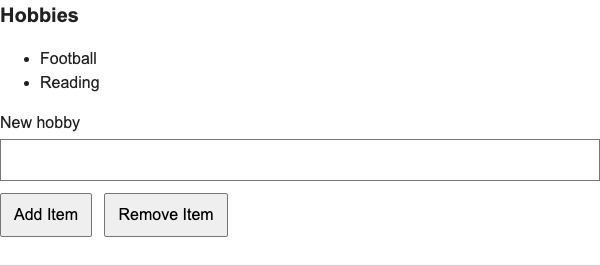

# Assignment 5 — JavaScript Basics

Name: BERDALIN YERBOL  
Group: IT-2513  
Repository: https://github.com/yerbolberdalin1/web-1---5assignment  
Live Demo: https://yerbolberdalin1.github.io/web-1---5assignment/

## Part 1 — Profile Object, Data Types and Arithmetic

### Task 1 — The Personal Info Object

userProfile is a const object with four properties: name (string), birthYear (number), isDeveloper (boolean), and hobbies (array). The birth year and hobbies are sample values.

### Task 2 — Arithmetic Calculations

The current year comes from new Date().getFullYear(). Age is calculated as the current year minus birthYear. Months are calculated as age multiplied by 12. Both results appear on the page and in the console. These are estimates based on the birth year.

## Part 2 — Form Input and Event Responses

### Task 3 — HTML Form Setup

The form contains Username and Birth Year inputs and a Create / Update Profile submit button.

### Task 4 — Event Listener

The submit listener prevents the page from reloading, reads both inputs, and updates userProfile. The displayed profile and calculations are refreshed. The profile text turns green to demonstrate changing styles through JavaScript.

## Part 3 — DOM List Manipulation

### Task 5 — Creating and Removing Elements

Hobbies are displayed in a `<ul>`. Add Item creates an `<li>` from the New hobby input. Remove Item deletes the last list element. The hobbies array is updated with the list. Empty input is ignored, and removing from an empty list causes no error.

## Work process

The project uses a separate HTML file, stylesheet, and JavaScript file. I implemented the five assignment tasks using standard DOM methods, event handling, and data structures. Browser checks covered profile updates, recalculations, adding hobbies, removing the last hobby, and an empty list.

